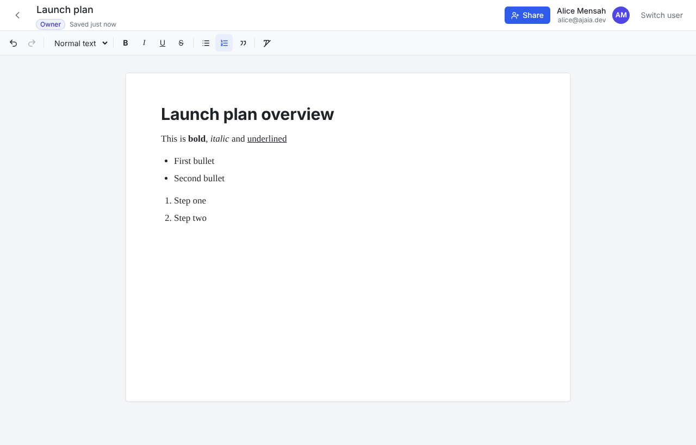

# Ajaia Docs

A lightweight collaborative document editor: create and format documents in the browser, import files, and share them with teammates as editors or viewers.

**Live demo:** `ajaia-docs-sigma-ten.vercel.app`. No sign-up is needed: pick a demo account on the login screen.

| Demo account | Role in the seeded data |
| --- | --- |
| `alice@ajaia.dev` | Owns *Welcome to Ajaia Docs*, which is shared with Bob (edit) and Carol (view) |
| `bob@ajaia.dev` | Editor on Alice's doc; owns *Bob's private notes* |
| `carol@ajaia.dev` | Viewer on Alice's doc (read-only editor) |

Auth is mocked on purpose (see [ARCHITECTURE.md](./ARCHITECTURE.md)). There are no passwords; open the avatar menu in the header and choose **Sign out** to change accounts.



## What works

- **Documents.** Create, rename (click the title), edit, delete (owner only) and reopen documents. Changes **autosave** about a second after you stop typing, and <kbd>Ctrl/⌘ S</kbd> saves immediately. A status shows *Unsaved changes… / Saving… / Saved*.
- **Rich text (TipTap).** Bold, italic, underline, strikethrough, Normal / Heading 1–3, bulleted and numbered lists, quotes, undo/redo and clear formatting. Standard keyboard shortcuts and Markdown-style shortcuts (`# `, `- `, `1. `) work too.
- **File import.** Upload a **`.txt`, `.md` or `.docx` file (up to 5 MB)** to create a new editable document. Headings, emphasis and lists carry over. Other file types are rejected with a clear message.
- **Sharing.** Owners share by email with **Can edit** or **Can view**, change roles, and revoke access. Collaborators can see who has access and can leave a document. The dashboard separates **My documents** from **Shared with me**, with role badges and "Shared by …" labels.
- **Access control is enforced on the server.** Viewers get a read-only editor, and the API also rejects their writes. Documents you can't access return 404, so IDs can't be probed.
- **Concurrent edit protection.** If two people edit the same version, the second save is rejected instead of silently overwriting the first. The user then chooses **Load their version** or **Keep mine**.
- **Persistence.** Postgres stores documents as sanitized HTML, so formatting survives a refresh exactly.

## Run locally

Requires **Node 22.12+** and **Postgres 14+**.

```bash
git clone <repo> ajaia-docs && cd ajaia-docs
npm install
cp .env.example .env            # defaults point at localhost:5432

# Start Postgres (skip if you already have one; then create databases "docs" and "docs_test")
docker compose up -d

npm run db:setup                # apply migrations and seed demo users/docs
npm run dev                     # http://localhost:3000
```

| Script | What it does |
| --- | --- |
| `npm run dev` / `build` / `start` | Next.js dev server / production build / production server |
| `npm test` | Vitest: unit tests, plus Postgres integration tests when `TEST_DATABASE_URL` is set |
| `npm run typecheck` | `tsc --noEmit` |
| `npm run db:migrate` | Apply SQL migrations in `drizzle/` |
| `npm run db:seed` | Create or refresh the demo accounts and docs. Idempotent and never overwrites edits |
| `npm run db:generate` | Generate a new migration after changing `src/db/schema.ts` |

### Tests

```bash
npm test
```

There are 32 tests in four files:

- `tests/permissions.test.ts` covers the role/permission matrix.
- `tests/session.test.ts` checks that session cookies can't be forged or swapped.
- `tests/import.test.ts` covers .txt/.md/.docx conversion (including a real .docx fixture), XSS stripping, and rejection of unsupported, empty, oversized and corrupt files.
- `tests/documents.integration.test.ts` runs against **real Postgres**. It covers the private-until-shared flow, editor vs viewer vs owner rights, stale-write conflict detection, role changes and revocation, and server-side sanitization.

There is also a browser smoke test of the whole user flow (`e2e/smoke.py`, Playwright). It produced the screenshots in `docs/screenshots/`. CI (`.github/workflows/ci.yml`) runs the typecheck, the tests against a Postgres service, and a build.

## Deploy (Vercel + Neon, both free)

1. Push the repo to GitHub and import it in **Vercel**.
2. In the Vercel project, open **Storage → Create → Neon Postgres** and connect it. This sets `DATABASE_URL` (and `DATABASE_URL_UNPOOLED`) automatically. Alternatively, create a free Neon project yourself and paste its pooled connection string as `DATABASE_URL`.
3. Add the env var `SESSION_SECRET`, set to a long random string (e.g. the output of `openssl rand -base64 32`).
4. Deploy. Vercel runs `npm run vercel-build`, which applies migrations, seeds the demo accounts and builds the app. Redeploys are safe because the seed is idempotent.

## Project layout

```
src/
  app/                  Next.js App Router pages + API route handlers
    api/documents/…     REST endpoints (CRUD, import, collaborators)
    documents/[id]/     Editor page: DocumentEditor, Toolbar, ShareDialog, useAutosave
  db/                   Drizzle schema, connection, seed data
  lib/
    documents.ts        Service layer; every function enforces access itself
    permissions.ts      Pure role → action rules
    import.ts           File → sanitized HTML (.txt / .md / .docx)
    sanitize.ts         HTML allow-list (server-side)
    session.ts, auth.ts HMAC-signed session cookie (mocked auth)
drizzle/                SQL migrations
tests/                  Vitest unit + integration tests
e2e/smoke.py            Playwright end-to-end flow
```

## Known limitations

- Collaboration is not real-time. Two people can edit the same doc, and conflicting saves are detected and resolved explicitly, but you don't see each other's cursors live.
- Import creates a *new* document. Importing into an existing doc, attachments and export aren't implemented.
- Auth is simulated with seeded accounts, and sharing only works with existing accounts (no invites).

See [ARCHITECTURE.md](./ARCHITECTURE.md) for the reasoning behind these choices and what I'd build next.

## Visual and accessibility checks (Playwright)

`npm run test:e2e` runs `e2e/a11y.spec.ts` (axe, WCAG 2.2 AA, every route in `src/app`, light and dark scheme) and `e2e/visual.spec.ts` (screenshots at 1280 and 390px) against a **running production server** at `BASE_URL` (default `http://localhost:3100`).

- **In CI:** the `e2e` job in `.github/workflows/ci.yml` seeds a throwaway Postgres service, builds, starts the server, runs the tests, and uploads the Playwright report when they fail. The job runs in GitHub's Playwright image; you need no Docker locally.
- **Locally (a11y only):** `npm run build && PORT=3100 npm start`, then `npx playwright test e2e/a11y.spec.ts`. Use a seeded Neon *branch* via `DATABASE_URL`, not production data. Local screenshots will not match the Linux baselines, so do not run the visual spec on a Mac.
- **Updating baselines after an intentional design change:** run the **Update visual baselines** workflow from the GitHub Actions tab, download the `visual-baselines` artifact into `e2e/__screenshots__/`, commit it, and explain the change in the PR. Never update baselines to make an unexplained diff pass.
